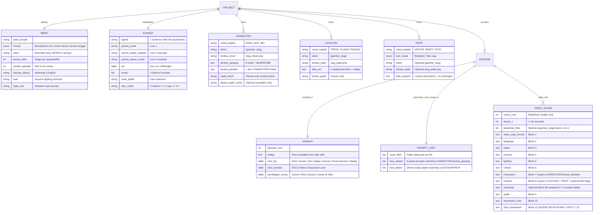
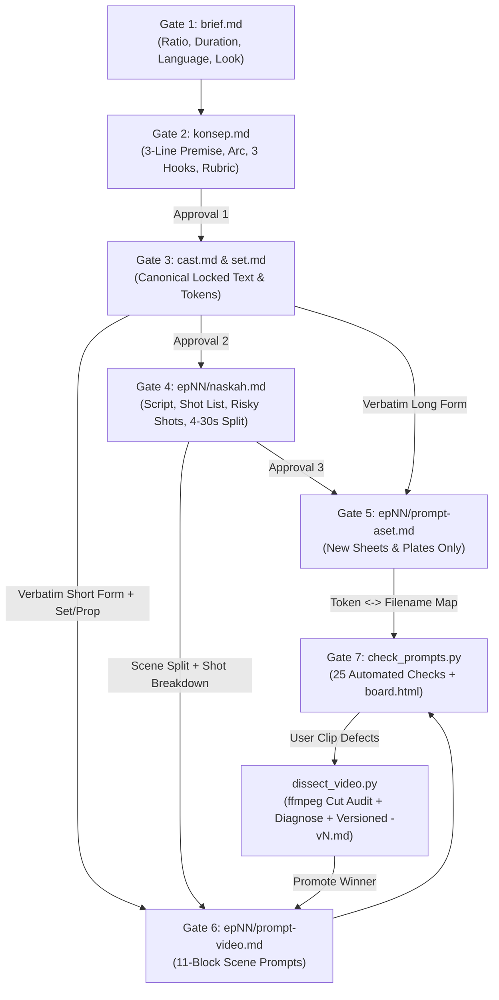

# Entity-Relationship & Data Integrity Architecture (`ERD.md`)

Microdrama enforces consistency across disparate AI image and video generations via **strict text-to-file token bijection** and **one-way data flow** from locked bibles (`cast.md`, `set.md`) into downstream asset and video prompts.

## 1. Entity-Relationship Diagram

---

## 2. Token Bijection & Gate Verification Data Flow

---

## 3. Canonical Token & File Naming Rules
1. Every reference image asset uses a strict lowercase alphanumeric/underscore `<slug>`:
   - **Character Sheet**: Token `[gambar_<slug>]` <-> File `<slug>_sheet.png` (e.g. `[gambar_adit]` <-> `adit_sheet.png`).
   - **Wardrobe Variant Sheet**: Token `[gambar_<slug>_b]` <-> File `<slug>_b_sheet.png` (e.g. `[gambar_rafa_b]` <-> `rafa_b_sheet.png`).
   - **Location or Plated Prop**: Token `[gambar_<slug>]` <-> File `<slug>_plate.png` (e.g. `[gambar_teras]` <-> `teras_plate.png`).
2. `check_prompts.py` enforces that:
   - Every `[gambar_<slug>]` in a scene block has its exact corresponding `<slug>_sheet.png` or `<slug>_plate.png` listed in that scene's `Lampirkan:` line.
   - No file in `Lampirkan:` is unused inside the prompt block (prevents wasted or confusing model conditioning).
   - No asset already defined in `ep01..ep(N-1)` is duplicated as a new generation block in `epN/prompt-aset.md`.
