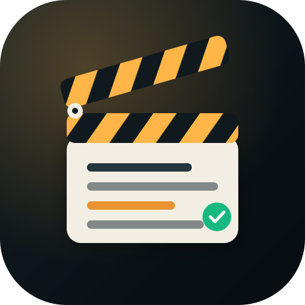

<div align="center">



# Microdrama v2.0 — Sovereign Precision Edition

**Rancang film & microdrama AI layaknya produksi sungguhan — dengan verifikasi semantik 25-poin, sinkronisasi bible otomatis, studio produksi HTML, dan loop bedah klip pasca-generate.**

[](CHANGELOG.md)
[](LICENSE)
[](assets/tools/check_prompts.py)
[](#what-new-in-v20)

[Kenapa Microdrama](#kenapa-microdrama) · [Peningkatan v2.0](#peningkatan-utama-v20) · [Alur 7 Gerbang](#alur-kerja-7-gerbang) · [Quick Start CLI](#quick-start-cli) · [Arsitektur](#tata-letak-berkas)

</div>

---

## Kenapa Microdrama

Video AI gagal secara **prediktif**: wajah tokoh berubah antar klip, figuran menoleh serempak seperti paduan suara, label paket berubah jadi huruf alien, adegan terasa seperti montase trailer, atau tokoh tiba-tiba menembus sisi pintu yang salah setelah potongan kamera.

**Microdrama** mengunci disiplin seorang sutradara dan *script supervisor* ke dalam **7 gerbang produksi** dan **perkakas verifikasi deterministik** sebelum Anda menghabiskan satu kredit generate pun.

Microdrama **tidak menggenerate media sendiri**. Anda memperoleh berkas teks terverifikasi plus **`board.html`** (Studio Produksi lokal) untuk di-copy ke AI gambar & video mana pun yang Anda pakai.

---

## Peningkatan Utama v2.0

Dirancang dengan arsitektur **Sovereign Precision Edition v2.0** agar jauh lebih **presisi** dan **powerfull**:

1. **Verifikator Semantik 25-Poin (`assets/tools/check_prompts.py`)**
   - Melampaui cek salinan blok & timecode v1.3.0 dengan mengotomatisasi **seluruh item kritis yang dulunya manual**:
     - Deteksi **tabrakan posisi kamera berurutan** di `naskah.md` & `SHOT BREAKDOWN`.
     - Verifikasi **paritas `naskah.md` ↔ `prompt-video.md`** (jumlah scene & durasi).
     - Deteksi **angka mentah di dialog** (`2011` → harus `"dua ribu sebelas"`) & **kecepatan bicara** (`> 3,2 kata/detik` memperingatkan risiko lip-sync).
     - **Pemindai klise sinetron** Indonesia & kata kosong (`8k`, `cinematic masterpiece`) di konsep, naskah, hingga prompt.
     - **Detektor tanda wajah ilegal** (menolak luka/tahi lalat/tato di blok tokoh kecuali dikecualikan lewat `Tanda wajah karena cerita:`).
     - **Detektor kontaminasi shot celah/kaca** (mencegah kata orang/`no face` masuk ke shot intip).
     - **Validasi anti-sinkronisasi figuran** di `MOVEMENT NOTE` & **audit rubrik `konsep.md`** + **audit reuse aset lintas episode**.
   - Mendukung mode `--json` dan `--strict`.

2. **CLI Produksi & Studio HTML Interaktif (`assets/tools/microdrama_cli.py`)**
   - `init` & `add-ep`: Scaffolding proyek baru & episode lanjutan beserta daftar aset `Pakai ulang`.
   - `sync`: Menyinkronkan blok terkunci dari `cast.md`/`set.md` dan daftar `Lampirkan:` ke seluruh episode secara atomik — **nol drift manual**.
   - `board`: Menghasilkan **`board.html`** — Studio Produksi lokal mode gelap yang memuat Brief, Konsep, Rubrik, Cast & Set Bible, Timeline Shot visual, Lencana Risiko, Status Checker, dan tombol **Copy Clean Prompt** sekali klik.

3. **Loop Bedah Klip & Perbaikan Terarah (`assets/tools/dissect_video.py`)**
   - `diagnose "<gejala>"`: Pencarian cepat 24 gejala video cacat → akar masalah di teks → perbaikan bedah 1–2 kalimat.
   - `analyze <clip.mp4> --prompt <epNN/prompt-video.md>`: Ekstraksi cut `ffmpeg`, pembuatan *contact sheet* 2 fps, dan pembandingan otomatis terhadap timecode `SHOT (a-bs)`.
   - `branch` & `promote`: Manajemen versi perbaikan aman (`prompt-video-v2.md`, `-v3.md`) agar Anda bisa kembali jika hasil generate memburuk.

4. **Panduan Deployment Model-Agnostik (`references/model-profiles.md`)**
   - Tabel pemetaan cara menempelkan token `[gambar_x]`, rasio, dan durasi ke Kling 3.0/4.0, Seedance 2.0, Veo 3, Sora 2, Runway Gen-4, Wan 2.6, GPT Image 2.5, dan Flux 2 tanpa mencemari isi prompt.

5. **Dua Proyek Benchmark Utuh**
   - `assets/contoh/alamat-yang-sama/` (3 episode × 30 detik, multi-plate, lengkap)
   - `assets/contoh/unit-7/` (1 episode × 30 detik lengkap + potongan lepas kompatibilitas v1.3.0)

---

## Alur Kerja 7 Gerbang

| Gerbang | Tahap | Keluaran | Persetujuan |
|---|---|---|---|
| **0** | Tempat kerja | Inisialisasi folder atau muat bible seri lama | — |
| **1** | Brief (`references/brief.md`) | `brief.md` (2 kartu tanya, zero-default) | Konfirmasi bentrok (jika ada) |
| **2** | Konsep (`references/konsep.md`) | `konsep.md` (Logline, Premis 3 baris, Arc, 3 Hook, Rubrik) | **Persetujuan 1** |
| **3** | Cast & Set (`references/cast.md`) | `cast.md` + `set.md` (blok terkunci & token `[gambar_x]`) | **Persetujuan 2** |
| **4** | Naskah + Shot List | `epNN/naskah.md` (Dialog, Shot List, Shot Berisiko, Split 4–30s) | **Persetujuan 3** |
| **5** | Prompt Aset (`references/prompt-aset.md`) | `epNN/prompt-aset.md` (Sheet 3-panel + Set/Prop plate baru saja) | — |
| **6** | Prompt Video (`references/prompt-video.md`) | `epNN/prompt-video.md` (11 blok tetap + `CONTINUITY` opsional) | — |
| **7** | Verifikasi & Serah | Lolos 25 cek (`check_prompts.py`) + `board.html` + panduan generate | **Final Gate** |

---

## Quick Start CLI

Tanpa dependensi Python eksternal (cukup Python 3.10+):

```bash
# 1. Buat proyek baru
python assets/tools/microdrama_cli.py init film/proyek-baru --title "Proyek Baru"

# 2. Tambah episode baru (otomatis mendeteksi aset reuse)
python assets/tools/microdrama_cli.py add-ep film/proyek-baru 2 --title "Episode Dua"

# 3. Sinkronkan blok terkunci dari cast.md & set.md ke seluruh prompt
python assets/tools/microdrama_cli.py sync assets/contoh/alamat-yang-sama

# 4. Jalankan 25-point verifier
python assets/tools/check_prompts.py assets/contoh/alamat-yang-sama --strict

# 5. Bangun Studio Produksi Visual (board.html)
python assets/tools/microdrama_cli.py board assets/contoh/alamat-yang-sama

# 6. Diagnosis gejala setelah generate video
python assets/tools/dissect_video.py diagnose "tokoh bocor ke sisi pintu"

# 7. Jalankan seluruh suite pengujian
python -m unittest discover -s tests -v
```

---

## Tata Letak Berkas

```text
├── SKILL.md                     # Instruksi master 7 gerbang untuk AI Agent
├── PRD.md · ERD.md · DOCUMENTATION.md
├── .claude-plugin/              # Manifes plugin & marketplace (v2.0.0)
├── references/
│   ├── brief.md                 # Gerbang 1: 2 kartu tanya, aturan zero-default
│   ├── konsep.md                # Gerbang 2 & 4: format, sumbu 180°, shot berisiko, split 4-30s
│   ├── copywriting.md           # Hukum anti-generik, detektor klise, pacing bicara, rubrik
│   ├── cast.md                  # Gerbang 3: blok panjang/pendek, wajah biasa, set, properti
│   ├── prompt-aset.md           # Gerbang 5: sheet 3 panel berlabel nama, plate sudut wide
│   ├── prompt-video.md          # Gerbang 6: 11 blok + CONTINUITY + triad lokasi ganda
│   ├── verifikasi.md            # Gerbang 7: 25 cek otomatis, 24 gejala, loop perbaikan
│   └── model-profiles.md        # Panduan pemetaan ke Kling, Seedance, Veo, Sora, Flux, GPT Image
├── assets/
│   ├── template/                # 7 kerangka kosong proyek baru
│   ├── tools/
│   │   ├── check_prompts.py     # Verifikator otomatis 25-poin (--json, --strict)
│   │   ├── microdrama_cli.py    # CLI init, add-ep, sync, board.html, check
│   │   └── dissect_video.py     # Diagnosa 24 gejala, analisis ffmpeg, branch/promote
│   └── contoh/
│       ├── alamat-yang-sama/    # Proyek lengkap 3 ep × 30s (multi-plate & reuse)
│       ├── unit-7/              # Proyek lengkap Unit 7 Ep 01
│       └── cast.md, konsep.md, prompt-video.md, rafa_sheet.png (referensi potongan)
└── tests/
    └── test_microdrama.py       # Pengujian otomatis komprehensif
```

---

## Lisensi

[MIT](LICENSE) © 2026 Roedy Rustam.
